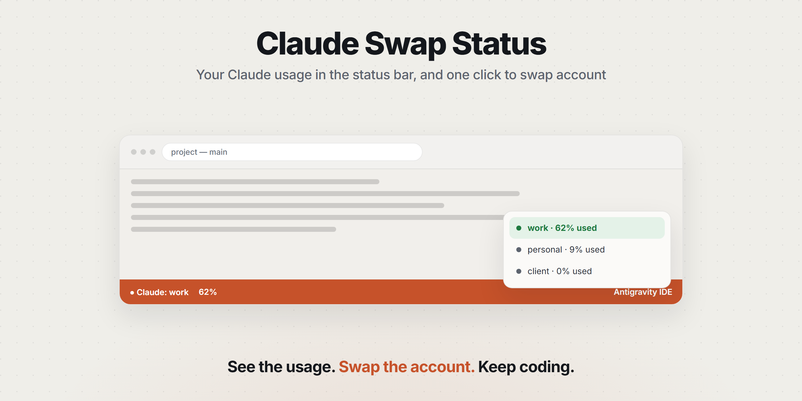

<div align="center">


# Claude Swap Status

**See your Claude Code usage in the status bar of Antigravity IDE or VS Code, and give each window its own Claude account.**

<a href="https://open-vsx.org/extension/smith89k/claude-swap-status"></a>
<a href="https://marketplace.visualstudio.com/items?itemName=smith89k.claude-swap-status"></a>
<a href="https://github.com/smith89k/claude-swap-status/blob/main/LICENSE"></a>

</div>

<picture>
  <source media="(prefers-color-scheme: dark)" srcset="art/banner-dark.png">
  
</picture>

Open two or three Antigravity IDE (or VS Code) windows, and let each one use a different Claude account. The status bar shows how much of your limits the window's account has used, and a side panel lets you add accounts and switch any window with one click.

It works on its own. Nothing else needs to be installed.

> **Unofficial.** This extension is not made by or affiliated with Anthropic. "Claude" is a trademark of Anthropic.

## Install

**From the extension store (recommended)**

1. Open the Extensions panel.
2. Search for **Claude Swap Status** and click **Install**.

It is published on [Open VSX](https://open-vsx.org/extension/smith89k/claude-swap-status) (used by Antigravity IDE and other VS Code-based editors) and the [VS Code Marketplace](https://marketplace.visualstudio.com/items?itemName=smith89k.claude-swap-status). Updates install automatically.

**From a `.vsix` file**

1. Download the latest `.vsix` file from the [Releases](https://github.com/smith89k/claude-swap-status/releases) page.
2. In the Extensions panel, click the `...` menu and choose **Install from VSIX...**.
3. Pick the file you downloaded.

## How it works

- Your normal Claude login is your **main account**, marked with a crown 👑. It starts as **Claude 1**, and every window uses it until you pick something else.
- Accounts you add start as **Claude 2**, **Claude 3**, and so on. You can rename any account, the main one included, and the new name replaces the starting one.
- Each extra account gets its own Claude folder inside `~/.claude-accounts`.
- Each window remembers which account it uses. When the window opens, the extension tells Claude in that window to use that account's folder, before Claude starts. Terminals in that window get the same account.
- Your settings, plugins, skills, memory and chat history are shared with every account. Only the login is different.

## Add an account

1. Click the **Claude Accounts** icon in the Activity Bar, then **Add account**. (Or run **Claude Swap: Add Account** from the Command Palette.)
2. The window reloads, and the Claude panel asks you to sign in. Sign in with the other account.
3. The new account appears with the next free number, like **Claude 2**. Rename it whenever you like, for example to `work`.

## Switch a window's account

Click the status bar item and pick an account, or click **Use here** next to an account in the side panel. Only that window reloads. Your other windows keep their accounts.

Switching reloads the window, so let Claude finish what it is doing first.

## The side panel

- **This window** shows the account this window uses, with its 5-hour and weekly meters.
- The small tick on each meter shows how much of that time window has already passed. If the bar reaches past the tick, you are using that limit faster than time is passing.
- **Other accounts** shows every other account, its usage, and which windows it is open in. Click **Use here** to switch this window to it.
- Hover an account to rename or delete it.
- The main account 👑 can be renamed but not deleted, because its folder is Claude's own (your settings and chat history live there). Its delete icon is greyed out.
- Deleting the account this window uses switches the window to your main account and reloads it first, then deletes the account.
- The panel fits any sidebar width. On a narrow sidebar the buttons move under the name and the reset times move into the tooltip.

## The status bar

```text
👤 work | 5h: █░░░░ 25% R:3h12m | 7d: █░░░░ 16% R:1d4h
```

- The main account shows 👑 instead of 👤.
- **5h** is your 5-hour usage limit, and **7d** is your weekly limit.
- **R:** is how long until that limit resets (`45m`, `3h12m`, `1d4h`).
- Hover over it to see the email, plan and exact reset times.
- A clock icon (🕒) at the end means the numbers are the last known ones. Hover to see how old they are.

The status bar changes colour so you notice before you run out:

| Usage          | Colour |
| -------------- | ------ |
| Below 70%      | Normal |
| 70% or more    | Yellow |
| 85% or more    | Red    |

## Commands

Open the Command Palette (`Ctrl+Shift+P` / `Cmd+Shift+P`) and type **Claude Swap**:

| Command                                       | What it does                                              |
| --------------------------------------------- | --------------------------------------------------------- |
| `Claude Swap: Switch Account`                 | Pick the account for this window.                         |
| `Claude Swap: Add Account`                    | Add a new account. The window reloads so you can sign in. |
| `Claude Swap: Use Account in This Window`     | Same as Switch Account, without the extra menu items.     |
| `Claude Swap: Switch This Window to the Main Account` | Put this window back on your normal login.   |
| `Claude Swap: Rename Account`                 | Give an account a new name, like "work".                 |
| `Claude Swap: Delete Account`                 | Delete an account you no longer use.                      |
| `Claude Swap: Refresh Usage`                  | Update the usage numbers right now.                       |
| `Claude Swap: Open Accounts Panel`            | Show the side panel.                                      |

## Settings

| Setting                           | Default | Description                                                 |
| --------------------------------- | ------- | ----------------------------------------------------------- |
| `claudeSwap.pollIntervalMinutes`  | `1`     | How often to check usage, in minutes (minimum `0.5`).       |
| `claudeSwap.confirmBeforeReload`  | `true`  | Ask before reloading a window to switch its Claude account. |

## Good to know

- **Windows only:** your `settings.json`, `CLAUDE.md` and `keybindings.json` are copied into each account's folder when a window opens. Make changes to them in a window on your main account; a change made in an account window is replaced the next time it opens. On macOS and Linux they are shared directly.
- **Claude in Chrome** works only in windows that use the same claude.ai account as the Chrome extension. Your Chrome extension is usually signed in to your main account, so windows on other accounts can't use Chrome tools. To use Chrome with another account, sign the Chrome extension in to that account, then type `/chrome` in Claude in that window to turn it on. Windows on your main account lose Chrome until you sign the extension back in.
- **Deleting an account** removes only that account's folder in `~/.claude-accounts`. Your shared chat history, memory and settings stay where they are.
- **Usage numbers** come from an unofficial Claude endpoint, so they could stop working if Anthropic changes it.
- **Logins are kept fresh safely.** Claude renews the login of any account that is in use. The extension only renews a login when no window and no Claude session is using that account, so nobody gets signed out.
- **Remote windows** (SSH, WSL, dev containers) are not supported yet.

## Upgrading from 0.2.x

This version no longer uses claude-swap, so your accounts saved in claude-swap are not imported. Add each account once with **Add account** and sign in. The `claudeSwap.cswapExecutablePath` setting is gone.

## Troubleshooting

**Claude in a window still uses the old account**

Reload the window (run **Developer: Reload Window**). If it keeps happening, check that `claudeCode.environmentVariables` in your settings does not set `CLAUDE_CONFIG_DIR`. That setting applies to every window, so each window can't have its own account while it is there. The extension warns you if it finds it.

**An account says "Not signed in yet" or "Sign-in expired"**

Click **Sign in** (or **Sign in again**) next to it in the side panel. The window switches to that account, and you can sign in from the Claude panel by typing `/login`.

**The numbers say "Last known" or show a clock icon**

The extension couldn't check usage just now, for example because the login is being renewed. The numbers update on the next check. Nothing to do.

**"Checked too often, trying again soon"**

The usage service asked for fewer checks. The extension waits as asked and tries again on its own. If you see this often, raise `claudeSwap.pollIntervalMinutes`.

## Development

1. Clone this repository and open the folder in Antigravity IDE or VS Code.
2. Run `npm install`.
3. Run `npm test` for the unit tests.
4. Run `npm run test:launch` to start a separate VS Code with a fake, empty home folder and check the extension end to end. Set `VSCODE_EXECUTABLE` to the path of an installed VS Code to skip the download.
5. Press `F5` to launch the Extension Development Host.
6. Run `npx @vscode/vsce package` to create a `.vsix` file.

## Credits

- [claude-swap](https://github.com/realiti4/claude-swap) by realiti4. This extension used to be an add-on for it, and the way it finds, locks and renews Claude logins follows claude-swap's careful work. Thank you.

## License

[MIT](LICENSE)
